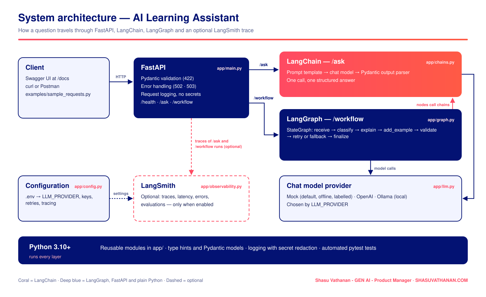
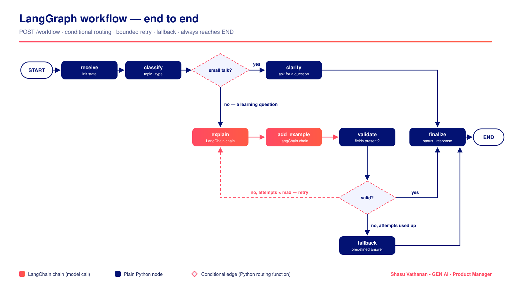

<!-- brand:header:start -->
<p align="center">
  
  <br><br>
  
  <br><br>
  <a href="https://SHASUVATHANAN.COM">SHASUVATHANAN.COM</a> &nbsp;&#8226;&nbsp; <a href="https://www.linkedin.com/in/shasuvathanan">LinkedIn</a>
</p>
<!-- brand:header:end -->

# LangChain vs LangGraph vs LangSmith Explained — AI Learning Assistant

**Shasu Vathanan - GEN AI - Product Manager**

$\textcolor{#FF4A62}{\rule{26em}{4pt}}$

📘 **Explainer:** [LangChain-vs-LangGraph-vs-LangSmith-Explained-Explainer.pdf](./LangChain-vs-LangGraph-vs-LangSmith-Explained-Explainer.pdf) — this folder in a 4-page branded guide · 📗 **Complete guide:** [docs/LangChain-LangGraph-LangSmith-Guide.pdf](./docs/LangChain-LangGraph-LangSmith-Guide.pdf) (13 pages)

**Build with LangChain, orchestrate with LangGraph, observe with LangSmith — served by FastAPI and written in Python.**

This project is an **AI Learning Assistant**: send it a question such as *"What is Agentic AI? Explain with a simple real-world example."* and it returns a beginner-friendly explanation, key points and a practical example as validated JSON. Each technology does the job it is best at, and a deterministic **mock mode** lets you run, test and explore everything without an API key.

<p align="center">
  
</p>

---

## Quick Navigation

| Learn | Build and run | Reference |
| :-- | :-- | :-- |
| [Learning objectives](#learning-objectives) | [Project overview](#ai-learning-assistant--project-overview) | [Sample requests and responses](#sample-requests-and-responses) |
| [What is LangChain?](#what-is-langchain) | [System architecture](#system-architecture) | [LangSmith observability](#langsmith-observability-configuration) |
| [What is LangGraph?](#what-is-langgraph) | [End-to-end workflow](#end-to-end-workflow) | [Testing](#testing) |
| [What is LangSmith?](#what-is-langsmith) | [Folder structure](#project-folder-structure) | [Troubleshooting](#common-errors-and-troubleshooting) |
| [Comparison](#langchain-vs-langgraph-vs-langsmith) | [Windows 11 installation](#windows-11-installation) | [Key takeaways](#learning-outcomes-and-key-takeaways) |
| [FastAPI and Python](#understanding-fastapi-and-python-integration) | [Running the server](#running-the-fastapi-server) | [References & Documentation](#references--documentation) |

---

## Learning objectives

By the end of this project you will be able to:

1. Explain what **LangChain**, **LangGraph** and **LangSmith** each do — and how they relate.
2. Build LangChain chains with a **prompt template**, a **chat model** and a **structured output parser**.
3. Design a **LangGraph** workflow with state, conditional routing, a bounded retry and a fallback.
4. Add optional **LangSmith** tracing and a small **evaluation**.
5. Serve an AI workflow with **FastAPI**: validation, status codes, consistent errors and Swagger UI.
6. Test an AI application **offline** with pytest and a deterministic mock model.

---

## What is LangChain?

**LangChain is the building kit.** It is an open-source framework for building applications with language models. Instead of writing provider-specific code, you use standard components and join them with **LCEL** (LangChain Expression Language), written with the `|` operator:

```python
chain = prompt_template | chat_model | output_parser
answer = chain.invoke({"topic": "LangGraph", "question": "What is LangGraph?"})
```

| Component | What it does | In this project |
| :-- | :-- | :-- |
| Chat model | One interface for many providers | [app/llm.py](./app/llm.py) — mock, OpenAI or Ollama |
| Prompt template | Fills variables into chat messages | `ChatPromptTemplate` in [app/chains.py](./app/chains.py) |
| Output parser | Turns text into a typed object — or fails clearly | `PydanticOutputParser` |
| Chain | Steps joined with LCEL | explain, example and answer chains |

**Why it helps:** changing the model provider is a configuration change, prompts are reusable, and structured output turns free text into data an API can trust.

**Grounding:** for topics the project knows (Agentic AI, LangChain, LangGraph, LangSmith, RAG, embeddings, FastAPI and more), the prompt includes short background notes from [app/knowledge.py](./app/knowledge.py). The model writes its own answer but takes its facts from the notes — this kept a small 0.5B local model from inventing wrong definitions in testing. The prompts also show the expected reply as a short JSON template, which small models follow far more reliably than a full JSON schema.

## What is LangGraph?

**LangGraph is the control room.** It is an open-source framework for **stateful, multi-step workflows** expressed as a graph:

- **State** — a typed dictionary that every step reads and updates.
- **Nodes** — Python functions; each does one step.
- **Edges** — what runs next. **Conditional edges** call a small Python function to choose the next node.

That makes branching, loops with limits, retries and human approval explicit, predictable and testable. **LangGraph does not require LangChain:** any Python function can be a node. In this project four nodes are plain Python and two call LangChain chains.

## What is LangSmith?

**LangSmith is the flight recorder.** It is a hosted platform for **observing, debugging and evaluating** LLM applications. With tracing on, every run becomes a **run tree** — the workflow, each node and each model call — with inputs, outputs, errors, latency and token usage. **Datasets** and **evaluators** score answers so you can compare versions.

LangSmith is **optional** and is **not an execution engine**: it records and evaluates runs; your code runs the same without it. Hosted LangSmith needs an account, an API key and internet access, and is subject to the plan's limits.

---

## LangChain vs LangGraph vs LangSmith

| | LangChain | LangGraph | LangSmith |
| :-- | :-- | :-- | :-- |
| **Remember it as** | **Build** | **Orchestrate** | **Observe** |
| **What it is** | Framework for LLM application components | Framework for stateful workflow graphs | Hosted tracing and evaluation platform |
| **Core ideas** | Chat models, prompts, parsers, tools, LCEL | State, nodes, edges, conditional routing | Traces, run trees, datasets, evaluators |
| **Use it when** | One or a few model calls with clear input and output | Step order matters: branching, retries, approvals, long-running state | You need to see why an answer happened, what it cost and how long it took |
| **Runs your code?** | Yes | Yes | No — it observes |
| **In this project** | `/ask` and the explain/example chains | `/workflow` | Optional tracing and [examples/evaluate.py](./examples/evaluate.py) |

**How they relate:** they are **complementary, not a required sequence**. LangChain components often run *inside* LangGraph nodes, and LangSmith can observe either — but LangGraph can orchestrate plain Python, and neither framework needs LangSmith to run.

## Understanding FastAPI and Python integration

**FastAPI** is a Python web framework for HTTP APIs. The request and response shapes are Pydantic models in [app/schemas.py](./app/schemas.py), so FastAPI validates input automatically, returns clear errors and generates the **OpenAPI** specification and **Swagger UI**. **Python** runs every layer: configuration, safe logging, the chains, the graph, the API and the tests.

| Concern | How it is handled |
| :-- | :-- |
| Validation | A question must be 3–500 characters after trimming; blank, missing or wrong type → **422** |
| Errors | One shape for every error: `{"status": "error", "error": "<code>", "detail": ...}` |
| Status codes | **200** success · **422** invalid request · **502** model failed (`/ask`) · **503** provider not usable |
| Logging | Method, path, status, duration and a request id — never bodies or headers; API keys are masked |

## Practical real-world use cases

| Situation | Good choice |
| :-- | :-- |
| Summarise an email into three bullet points | **LangChain** alone — one chain |
| Answer, check the answer, retry once, otherwise use a safe fallback | **LangGraph**, with LangChain chains inside nodes |
| Route customer requests to different steps (refund, order status, human agent) | **LangGraph** conditional routing |
| A user reports a wrong answer and you need to know which step caused it | **LangSmith** trace of that run |
| You changed a prompt and want proof that answers did not get worse | **LangSmith** evaluation on a dataset |
| A mobile app or website needs the assistant | **FastAPI** endpoint in front of the workflow |

---

## AI Learning Assistant — project overview

| | |
| :-- | :-- |
| **Input** | An educational question, through `POST /ask` or `POST /workflow` |
| **Output** | Topic, explanation, key points, a real-world example, status and mode — as validated JSON |
| **/ask** | **LangChain alone:** one prompt template, one model call, one structured answer |
| **/workflow** | **LangGraph:** classify → explain → add example → validate → bounded retry or fallback |
| **Models** | Mock (default, offline, labelled), OpenAI, or a local Ollama model |
| **Observability** | Optional LangSmith tracing; every workflow run returns a `trace_id` when tracing is on |

## System architecture

<p align="center">
  
</p>

A client calls **FastAPI**. `/ask` runs one **LangChain** chain on its own; `/workflow` runs the **LangGraph** workflow, whose `explain` and `add_example` nodes call LangChain chains. Every chain uses the chat model chosen by `LLM_PROVIDER`. When tracing is enabled, both kinds of run are recorded in **LangSmith**.

## End-to-end workflow

<p align="center">
  
</p>

| # | Step | Where |
| :-- | :-- | :-- |
| 1 | Receive the request | FastAPI `POST /workflow` |
| 2 | Validate the input | Pydantic `QuestionRequest` |
| 3 | Initialise the workflow state | node `receive` |
| 4 | Identify topic and explanation type | node `classify` (plain Python) |
| 5 | Prepare a prompt from a reusable template | `ChatPromptTemplate` in the explain chain |
| 6 | Invoke the model and parse the structured reply | node `explain` (LangChain) |
| 7 | Generate a practical real-world example | node `add_example` (LangChain) |
| 8 | Check explanation, key points and example | node `validate` |
| 9 | Retry once — never endlessly — then fall back | `route_after_validate` → `explain` or `fallback` |
| 10 | Record the run (when tracing is enabled) | LangSmith |
| 11 | Build the validated JSON response | node `finalize` + `WorkflowResponse` |
| 12 | Return the result | FastAPI → HTTP 200 |

### LangGraph node execution

| Node | Type | Reads | Writes |
| :-- | :-- | :-- | :-- |
| `receive` | Python | question | trimmed question, `attempts = 0`, `max_attempts` |
| `classify` | Python | question | `topic`, `question_type` (concept · comparison · how_to · small_talk) |
| `clarify` | Python | — | a friendly request for a learning question; status `needs_clarification` |
| `explain` | LangChain | topic, question, type | `explanation`, `key_points`, `attempts + 1`; on failure an error note |
| `add_example` | LangChain | topic, explanation | `example` |
| `validate` | Python | explanation, key points, example | `validation_errors` |
| `fallback` | Python | topic | a predefined answer; status `fallback` |
| `finalize` | Python | status | final status (`success` unless set) |

Two **conditional edges** decide the path: `route_after_classify` (small talk → `clarify`, otherwise → `explain`) and `route_after_validate` (valid → `finalize`; invalid with attempts left → `explain`; attempts used up → `fallback`). Every response lists the nodes it ran in `steps`, so the path is always visible.

---

## Project folder structure

```text
LangChain vs LangGraph vs LangSmith Explained/
├── README.md                     this guide
├── LangChain-vs-LangGraph-vs-LangSmith-Explained-Explainer.pdf
├── LangChain vs LangGraph vs LangSmith Explained.png    infographic
├── pyproject.toml                project metadata, dependency ranges, pytest settings
├── requirements.txt              exact tested versions
├── .env.example                  configuration template
├── .gitignore
├── app/
│   ├── main.py                   FastAPI app — endpoints, errors, logging
│   ├── config.py                 settings from .env, secret-safe logging
│   ├── schemas.py                Pydantic request, output and response models
│   ├── knowledge.py              classifier and predefined answers (mock mode, fallback)
│   ├── llm.py                    chat-model factory and the deterministic MockChatModel
│   ├── chains.py                 LangChain prompt templates and chains
│   ├── graph.py                  LangGraph workflow
│   └── observability.py          optional LangSmith tracing
├── tests/
│   ├── conftest.py               forces offline mock mode
│   ├── test_api.py
│   ├── test_workflow.py
│   └── test_ollama_integration.py   real local-model tests (opt-in)
├── examples/
│   ├── sample_requests.py        calls a running server
│   ├── sample_responses.json     real responses recorded in mock mode
│   ├── ollama_responses.json     real responses generated by qwen2.5:0.5b
│   └── evaluate.py               local evaluation, optional LangSmith experiment
├── assets/
│   ├── comparison.svg            editable source of the infographic
│   ├── architecture.svg
│   └── workflow.svg
└── docs/
    ├── LangChain-LangGraph-LangSmith-Guide.pdf
    ├── build_docs.py             rebuilds the diagrams, infographic and PDFs
    ├── diagrams.py
    └── guide.py
```

---

## Prerequisites

- Windows 11 (the steps also work on macOS and Linux with the usual path changes)
- **Python 3.10 or newer** — tested with Python 3.13
- Optional: an **OpenAI API key**, or **Ollama** for a free local model
- Optional: a **LangSmith** account and API key for hosted tracing

## Windows 11 installation

1. Install Python from [python.org](https://www.python.org/downloads/) and tick **Add python.exe to PATH**. Check it in PowerShell: `python --version`.
2. Open PowerShell in the project folder — the path contains spaces, so keep the quotes:

```powershell
cd "Phase-006-LangChain-Ecosystem\LangChain vs LangGraph vs LangSmith Explained"
```

### Python environment setup

```powershell
python -m venv .venv
.venv\Scripts\Activate.ps1
```

If PowerShell blocks the script, run `Set-ExecutionPolicy -Scope CurrentUser RemoteSigned` once, or use Command Prompt with `.venv\Scripts\activate.bat`.

### Dependency installation

```powershell
python -m pip install --upgrade pip
python -m pip install -r requirements.txt
```

`requirements.txt` pins the exact versions this project was tested with; `pyproject.toml` lists the compatible ranges.

### Environment configuration

```powershell
copy .env.example .env
```

| Variable | Default | Purpose |
| :-- | :-- | :-- |
| `LLM_PROVIDER` | `mock` | `mock` · `openai` · `ollama` |
| `OPENAI_API_KEY` · `OPENAI_MODEL` | — · `gpt-4.1-mini` | OpenAI access and model |
| `OLLAMA_MODEL` · `OLLAMA_BASE_URL` | `qwen2.5:0.5b` · `http://localhost:11434` | Local model served by Ollama |
| `LLM_TEMPERATURE` | `0.2` | Lower means more focused answers |
| `MAX_RETRIES` | `1` | Extra attempts when validation fails (0–3) |
| `LLM_TIMEOUT_SECONDS` | `60` | Per-call timeout for real models |
| `LANGSMITH_TRACING` · `LANGSMITH_API_KEY` · `LANGSMITH_PROJECT` | `false` · — · `ai-learning-assistant` | Optional tracing |
| `LOG_LEVEL` | `INFO` | Logging detail |

`.env` is git-ignored — never commit real keys.

## Mock mode and real LLM mode

| Mode | Set | What you get |
| :-- | :-- | :-- |
| **Mock** (default) | `LLM_PROVIDER=mock` | Predefined answers for core AI topics, always identical, no key and no network. Every response says *"Mock mode: a predefined sample answer, not generated by a language model."* |
| **OpenAI** | `LLM_PROVIDER=openai` and `OPENAI_API_KEY` | Answers generated by an OpenAI model (paid per token) |
| **Ollama** (local) | Install [Ollama](https://ollama.com/), run `ollama pull qwen2.5:0.5b`, set `LLM_PROVIDER=ollama` | Free, local generation — tested with `qwen2.5:0.5b` (see below) |

> [!NOTE]
> Mock answers are sample content, not live AI inference. The `mode` field in every response tells you which provider produced it.

**Tested with a real local model.** With Ollama 0.17.1 and `qwen2.5:0.5b` on Windows 11, 24 real requests (4 questions × `/ask` and `/workflow` × 3 rounds) all returned HTTP 200 with status `success` — no retries or fallbacks were needed — in 5–13 seconds each after the model had loaded (the very first call took about a minute). Recorded responses are in [examples/ollama_responses.json](./examples/ollama_responses.json). A 0.5B model is small: on known topics it sometimes repeats the background notes almost word for word, and its wording can be imprecise — use a larger model (for example `qwen2.5:3b`) or OpenAI when accuracy matters.

## Running the FastAPI server

```powershell
uvicorn app.main:app --reload
```

Open **http://127.0.0.1:8000/docs** for the Swagger UI. Stop the server with `Ctrl+C`.

## API endpoints and Swagger UI

| Method | Endpoint | Purpose |
| :-- | :-- | :-- |
| `GET` | `/health` | Application, provider, model and LangSmith status |
| `POST` | `/ask` | LangChain alone — one prompt, one model call, one structured answer |
| `POST` | `/workflow` | The complete LangGraph workflow |
| `GET` | `/docs` | Swagger UI — try every endpoint in the browser |
| `GET` | `/openapi.json` | The generated OpenAPI specification |

## Sample requests and responses

With the server running, in a second terminal:

```powershell
python examples/sample_requests.py

# or one request at a time
Invoke-RestMethod -Method Post -Uri http://127.0.0.1:8000/ask -ContentType "application/json" `
  -Body '{"question": "What is Agentic AI? Explain with a simple real-world example."}'
```

**`POST /ask`** — real response recorded in mock mode ([examples/sample_responses.json](./examples/sample_responses.json)):

```json
{
  "question": "What is Agentic AI? Explain with a simple real-world example.",
  "topic": "Agentic AI",
  "explanation": "Agentic AI refers to AI systems that can plan the steps needed to reach a goal, use tools such as search or calculators, check their own progress and continue until the task is done. Instead of answering one prompt, an agent works through a multi-step workflow, often asking a person to approve important actions.",
  "example": "An AI travel assistant can research destinations, compare flight and hotel options within your budget, and prepare an itinerary that it shows you for approval before anything is booked.",
  "status": "success",
  "mode": "mock",
  "note": "Mock mode: a predefined sample answer, not generated by a language model."
}
```

**`POST /workflow`** — the same question; fields that show the workflow:

```json
{
  "topic": "Agentic AI",
  "question_type": "concept",
  "key_points": ["Works toward a goal, not just a single reply", "Plans steps and chooses tools", "Keeps humans in the loop for important decisions"],
  "status": "success",
  "mode": "mock",
  "steps": ["receive", "classify", "explain", "add_example", "validate", "finalize"],
  "attempts": 1,
  "validation_errors": [],
  "trace_id": null
}
```

**Invalid request** — `{"question": "   "}` returns **422** in the shared error format:

```json
{"status": "error", "error": "validation_error", "detail": [{"field": "question", "message": "String should have at least 3 characters"}]}
```

More examples — a comparison question and small talk routed to `clarify` — are in [examples/sample_responses.json](./examples/sample_responses.json).

---

## LangSmith observability configuration

1. Create a LangSmith account and an API key.
2. In `.env`:

```text
LANGSMITH_TRACING="true"
LANGSMITH_API_KEY="your_langsmith_api_key"
LANGSMITH_PROJECT="ai-learning-assistant"
```

3. Restart the server. `/health` now shows `"langsmith": {"enabled": true, ...}` and every `/workflow` response carries a `trace_id` — the LangSmith run id — so the exact run can be found.
4. In LangSmith, open the project to see each run tree: every node and model call with inputs, outputs, errors and latency. Runs are tagged `langgraph`/`workflow` or `langchain`/`ask`, with the provider and model as metadata.
5. Evaluate: `python examples/evaluate.py` scores the workflow locally (topic, status, example). Add `--langsmith` to upload the dataset and create a LangSmith experiment.

Without a key, tracing switches off with a clear reason in `/health` and the application keeps working.

## Testing

```powershell
python -m pytest
```

The suite runs fully offline in mock mode (`tests/conftest.py` forces it) and covers:

| Area | What is checked |
| :-- | :-- |
| LangChain | Each chain returns its Pydantic type; mock output is deterministic |
| LangGraph | Node order, state passing, both conditional routes, retry then success, bounded retries then fallback, `MAX_RETRIES` respected |
| LangSmith | Tracing off without a key (with a reason), on with a key; the app works either way |
| FastAPI | 200 for `/health`, `/ask`, `/workflow`; 422 for blank, short, long, missing and wrong-type questions; 503 for an unusable provider; 502 for model failure and invalid output; fallback on `/workflow`; `/docs` and `/openapi.json` |
| Safety | API keys masked in logs; error bodies contain no internal details |

Result on Windows 11 with Python 3.13: **38 passed**.

**Real-model tests** (opt-in, need Ollama and the model; they are skipped otherwise):

```powershell
ollama pull qwen2.5:0.5b
python -m pytest -m ollama
```

They check that `/ask` and `/workflow` return answers generated by the model (`mode` is `ollama`, no mock note, not a predefined answer), that the structure is valid and that the workflow always finishes. Result with `qwen2.5:0.5b`: **4 passed**.

## Common errors and troubleshooting

| Problem | Fix |
| :-- | :-- |
| `uvicorn` is not recognised | Activate the virtual environment, or run `python -m uvicorn app.main:app --reload` |
| `Activate.ps1 cannot be loaded` | `Set-ExecutionPolicy -Scope CurrentUser RemoteSigned`, or use `activate.bat` in Command Prompt |
| `No module named 'app'` | Run commands from this project folder (the one with `pyproject.toml`) |
| 503 — `LLM_PROVIDER=openai needs OPENAI_API_KEY` | Add the key to `.env`, or set `LLM_PROVIDER=mock` |
| 502 from `/ask` with Ollama | Start Ollama, run `ollama pull qwen2.5:0.5b`, check `OLLAMA_MODEL` |
| `/workflow` returns `"status": "fallback"` | The model's answers failed validation twice; try a larger model or `MAX_RETRIES=2` |
| A small local model repeats the background notes or is imprecise | Expected with a 0.5B model; use `qwen2.5:3b` or larger, or OpenAI |
| The first Ollama request is very slow | The model is loading into memory; later requests are much faster |
| LangSmith shows no runs | Set `LANGSMITH_TRACING=true` and `LANGSMITH_API_KEY`, restart, check `/health` |
| Port 8000 is busy | `uvicorn app.main:app --reload --port 8001` |

---

## Learning outcomes and key takeaways

- **LangChain builds** the model calls: prompt templates, chat models and structured output.
- **LangGraph orchestrates** the steps: state, routing, bounded retries and fallbacks in plain Python.
- **LangSmith observes** and evaluates — optional, never required to run the application.
- **FastAPI serves** the workflow with validation, clear status codes and generated documentation.
- **Python** holds it all together — and a deterministic mock mode makes AI code testable.

---

## References & Documentation

| Topic | Official documentation |
| :-- | :-- |
| LangChain | [docs.langchain.com/oss/python/langchain/overview](https://docs.langchain.com/oss/python/langchain/overview) · [docs.langchain.com](https://docs.langchain.com/) |
| LangGraph | [docs.langchain.com/oss/python/langgraph/overview](https://docs.langchain.com/oss/python/langgraph/overview) |
| LangSmith | [docs.langchain.com/langsmith](https://docs.langchain.com/langsmith/) · [Evaluation](https://docs.langchain.com/langsmith/evaluation) |
| FastAPI | [fastapi.tiangolo.com](https://fastapi.tiangolo.com/) |
| Pydantic | [docs.pydantic.dev](https://docs.pydantic.dev/latest/) |
| Python | [docs.python.org/3](https://docs.python.org/3/) |
| Ollama | [docs.ollama.com](https://docs.ollama.com/) |

### Open-source libraries used

| Library | Licence (from package metadata) |
| :-- | :-- |
| langchain · langchain-core · langchain-openai · langchain-ollama · langgraph · langsmith (SDK) | MIT |
| fastapi · pydantic · pytest | MIT |
| uvicorn · python-dotenv · httpx · starlette | BSD-3-Clause |

Libraries are installed from `requirements.txt` and are not copied into this repository.

## Project author and maintenance

This educational project is independently developed and maintained by **Shasu Vathanan - GEN AI - Product Manager** as part of the GenAI Architect Journey. Rebuild the diagrams, infographic and PDFs after changing the content with `python docs/build_docs.py` — it needs `pip install reportlab pymupdf pillow` (the `docs` extra in `pyproject.toml`), Google Chrome and the repository's `zz-Brand-Assets/pdf-kit` engine.

---

## Navigation

| Up | Index | Previous track |
| :-- | :--: | --: |
| [Phase-006-LangChain-Ecosystem](../) | [Journey index](../../README.md) | [← Advanced Model Integration](../Langchain_Advanced_Model_Integration/) |

$\textcolor{#FF4A62}{\rule{20em}{2pt}}$

## Contributing

Feel free to fork this repository, improve the content, and share your knowledge with the community.

---

**Created and Maintained by:**

### **Shasu Vathanan - GEN AI - Product Manager**

<a href="https://shasuvathanan.com" target="_blank">SHASUVATHANAN.COM</a> &nbsp;&#8226;&nbsp; <a href="https://www.linkedin.com/in/shasuvathanan" target="_blank">LinkedIn</a>

<!-- brand:footer:start -->
<!-- brand:social:start -->
<p align="center">
  <a href="https://shasuvathanan.com"></a>
  &nbsp;
  <a href="mailto:shasu1pm@gmail.com"></a>
  &nbsp;
  <a href="https://linkedin.com/in/shasuvathanan"></a>
  &nbsp;
  <a href="https://github.com/shasu1pm"></a>
  &nbsp;
  <a href="https://huggingface.co/Shasuvathanan"></a>
  &nbsp;
  <a href="https://www.youtube.com/@ShasuVathanan"></a>
  &nbsp;
  <a href="https://x.com/shasuvathanan"></a>
  &nbsp;
  <a href="https://higgsfield.ai/@shasuvathanan"></a>
  <br>
  <sub><b>Connect:</b> <a href="https://shasuvathanan.com">Website</a> &nbsp;&#8226;&nbsp; <a href="mailto:shasu1pm@gmail.com">Email</a> &nbsp;&#8226;&nbsp; <a href="https://linkedin.com/in/shasuvathanan">LinkedIn</a> &nbsp;&#8226;&nbsp; <a href="https://github.com/shasu1pm">GitHub</a> &nbsp;&#8226;&nbsp; <a href="https://huggingface.co/Shasuvathanan">Hugging Face</a> &nbsp;&#8226;&nbsp; <a href="https://www.youtube.com/@ShasuVathanan">YouTube</a> &nbsp;&#8226;&nbsp; <a href="https://x.com/shasuvathanan">X (Twitter)</a> &nbsp;&#8226;&nbsp; <a href="https://higgsfield.ai/@shasuvathanan">Higgsfield AI</a></sub>
</p>
<!-- brand:social:end -->
<p align="center">
  
  <br>
  <sub><b>Shasu Vathanan - GEN AI - Product Manager</b> &nbsp;&#8226;&nbsp; NeGot, my AI avatar &nbsp;&#8226;&nbsp; <a href="../../README.md">Back to the journey index</a></sub>
</p>
<!-- brand:footer:end -->
