<!-- brand:header:start -->
<p align="center">
  
  <br><br>
  
  <br><br>
  <a href="https://SHASUVATHANAN.COM">SHASUVATHANAN.COM</a> &nbsp;&#8226;&nbsp; <a href="https://www.linkedin.com/in/shasuvathanan">LinkedIn</a>
</p>
<!-- brand:header:end -->

# Phase-006-LangChain-Ecosystem — LangChain Building Blocks

**Shasu Vathanan - GEN AI - Product Manager**

$\textcolor{#FF4A62}{\rule{26em}{4pt}}$

**The parts every LLM application is assembled from — loaders, splitters, embeddings, vector stores, retrievers, chains, models and messages.**

Phase-005-LLM-Foundations-and-Practical-Tools explained what a model is and how to run one. This phase puts a framework around the model. **LangChain** gives each step of an AI application a standard component, so a document can be loaded, split, embedded, stored, searched, and passed to any chat model with the same few lines of Python.

Nine beginner-friendly notebooks in two tracks, written to be run top to bottom.

---

## Quick Navigation

| # | Track | What it covers | Go to |
| :-- | :-- | :-- | :-- |
| 1 | **LangChain Components** | The seven building blocks of a retrieval (RAG) app, one notebook each | [Open](./Langchain-Components/) |
| 2 | **Advanced Model Integration** | Connecting LangChain to OpenAI, Ollama, Claude and Gemini, and talking to them with messages | [Open](./Langchain_Advanced_Model_Integration/) |

**Explainer PDFs:** [📄 LangChain-Ecosystem-Explainer.pdf](./LangChain-Ecosystem-Explainer.pdf) (this phase) · [📄 LangChain-Components-Explainer.pdf](./Langchain-Components/LangChain-Components-Explainer.pdf) · [📄 LangChain-Advanced-Model-Integration-Explainer.pdf](./Langchain_Advanced_Model_Integration/LangChain-Advanced-Model-Integration-Explainer.pdf)

---

## The LangChain ecosystem at a glance

| Layer | Package / product | Role |
| :-- | :-- | :-- |
| Protocol | `langchain-core` | Base interfaces and **LCEL** — the `|` operator that joins components into a chain |
| Integrations | `langchain-community`, `langchain-openai`, `langchain-huggingface`, … | Loaders, vector stores, embedding models and chat models from many providers |
| Application | `langchain` | Ready-made chains and agents built on the core |
| Observability | **LangSmith** | Traces every call — inputs, outputs, latency and tokens |

**Reference diagrams in this folder** (external diagrams kept for study; credit belongs to their original creators):

| Image | What it shows |
| :-- | :-- |
| [0-Block diagram of the LangChain ecosystem.png](./0-Block%20diagram%20of%20the%20LangChain%20ecosystem.png) | The LangChain stack — LangChain-Core, LangChain-Community, LangChain, Templates, LangServe and LangSmith |
| [1-Langchain components.jpg](./1-Langchain%20components.jpg) | Components of LangChain (credited *@Product Mindset* on the image) — Retrieval, LLMs, Memory, Prompt Templates and Agents feeding Chains |
| [2-Langchain components.png](./2-Langchain%20components.png) | A component tree — Models, Prompts, Indexes, Memory, Chains and Agents with their sub-parts |

---

## How the components connect

Each notebook in **LangChain Components** builds one box of this pipeline. Together they form the retrieval flow that Phase-007-RAG-Introduction builds on.

```mermaid
%%{init: {'theme':'base','themeVariables':{'primaryColor':'#FF4A62','primaryTextColor':'#FFFFFF','primaryBorderColor':'#FF5A45','lineColor':'#031273','secondaryColor':'#031273','secondaryTextColor':'#FFFFFF','tertiaryColor':'#F2F4FF','tertiaryTextColor':'#031273','fontFamily':'Segoe UI, Helvetica, Arial, sans-serif','fontSize':'15px'}}}%%
flowchart LR
    classDef coral fill:#FF4A62,stroke:#FF5A45,stroke-width:2px,color:#FFFFFF;
    classDef blue  fill:#031273,stroke:#031273,stroke-width:2px,color:#FFFFFF;
    A["01 · Load<br/>Document Loader"] --> B["02 · Split<br/>Text Splitter"] --> C["03 · Embed<br/>Embedding Model"] --> D["04 · Store<br/>Vector Store (FAISS)"]
    D --> E["05 · Retrieve<br/>Retriever"] --> F["06 · Answer<br/>Chain: Prompt → Model → Parser"]
    F -. traced by .-> G["07 · LangSmith"]
    class A,B,C,D coral;
    class E,F,G blue;
```



*In words:* a loader reads your data into Documents, the splitter cuts them into chunks, an embedding model turns each chunk into a vector, the vector store saves those vectors, the retriever fetches the chunks closest in meaning to a question, and a chain sends the question plus those chunks to a model. LangSmith records each run so it can be inspected.

---

## Track 1 — LangChain Components

| # | Notebook | What you learn |
| :-- | :-- | :-- |
| 01 | [01_Data_Ingestion.ipynb](./Langchain-Components/01_Data_Ingestion.ipynb) | Loading a text file into Documents with `TextLoader`; other common loaders such as `PyPDFLoader` |
| 02 | [02_Text_Splitter.ipynb](./Langchain-Components/02_Text_Splitter.ipynb) | `RecursiveCharacterTextSplitter`, and what `chunk_size` and `chunk_overlap` control |
| 03 | [03_Embeddings.ipynb](./Langchain-Components/03_Embeddings.ipynb) | Turning text into vectors with a free local Hugging Face model or OpenAI, and comparing meanings |
| 04 | [04_Vector_Store.ipynb](./Langchain-Components/04_Vector_Store.ipynb) | Storing vectors in FAISS, searching by meaning, and saving / reloading the store |
| 05 | [05_Retriever.ipynb](./Langchain-Components/05_Retriever.ipynb) | Retriever vs vector store, and fetching the top matches for a question |
| 06 | [06_Chains.ipynb](./Langchain-Components/06_Chains.ipynb) | The Prompt → Model → Output Parser chain with LCEL |
| 07 | [07_LangSmith.ipynb](./Langchain-Components/07_LangSmith.ipynb) | Tracing chains, your own functions (`@traceable`) and the raw OpenAI client (`wrap_openai`) |

Supporting files: [requirements.txt](./Langchain-Components/requirements.txt) · [.env.example](./Langchain-Components/.env.example) · [sample.txt](./Langchain-Components/sample.txt) (created by notebook 01) · [my_store/](./Langchain-Components/my_store/) (the FAISS index saved by notebook 04).

## Track 2 — Advanced Model Integration

| # | Notebook | What you learn |
| :-- | :-- | :-- |
| 01 | [01_Model_Integration.ipynb](./Langchain_Advanced_Model_Integration/01_Model_Integration.ipynb) | `ChatOpenAI`, `invoke()`, common settings and streaming; switching to Ollama, Claude or Gemini |
| 02 | [02_Messages.ipynb](./Langchain_Advanced_Model_Integration/02_Messages.ipynb) | `SystemMessage`, `HumanMessage` and `AIMessage`, and holding a conversation by keeping the message list |

Supporting files: [requirements.txt](./Langchain_Advanced_Model_Integration/requirements.txt) · [.env.example](./Langchain_Advanced_Model_Integration/.env.example).

---

## Running the notebooks

```powershell
cd "Phase-006-LangChain-Ecosystem\Langchain-Components"
python -m venv venv
venv\Scripts\Activate.ps1
python -m pip install -r requirements.txt
copy .env.example .env      # then paste your own keys into .env
```

Open a notebook in VS Code or Jupyter and run the cells in order. Use the same steps in `Langchain_Advanced_Model_Integration`.

> [!IMPORTANT]
> Keys go in a local `.env` file, which is git-ignored. Only `.env.example` — with placeholder values — belongs in the repository. Notebooks 01, 02, 04 and 05 need no API key — they use the free Hugging Face embedding model (downloaded once on first run). The Chains, LangSmith and OpenAI cells need a key.

---

## Key takeaways

- LangChain does not replace the model — it standardises **everything around it**.
- A retrieval app is six swappable steps: **load → split → embed → store → retrieve → answer**.
- Changing provider is usually a one-line change of the chat-model class.
- Tracing with LangSmith makes each step visible, so problems can be debugged instead of guessed.

---

## Phase map

| Phase | Focus | Document |
| :-- | :-- | :-- |
| [Phase-001-Programming-Foundations](../Phase-001-Programming-Foundations/) | Python fundamentals — the Student Grade System in a terminal | [📄 PDF](../Phase-001-Programming-Foundations/Student%20Grade%20System.pdf) |
| [Phase-002-GenAI-Python-Toolkit](../Phase-002-GenAI-Python-Toolkit/) | Mandatory Python concepts for Generative AI | [📄 PDF](../Phase-002-GenAI-Python-Toolkit/Mandatory%20Python%20Concepts%20for%20Generative%20AI.pdf) |
| [Phase-003-Robotic-Process-Automation-(RPA)](../Phase-003-Robotic-Process-Automation-%28RPA%29/) | RPA — desktop and browser automation | [📄 PDF](../Phase-003-Robotic-Process-Automation-%28RPA%29/RPA%20-%20Robotic%20Process%20Automation.pdf) |
| [Phase-004-FastAPI-And-Streamlit](../Phase-004-FastAPI-And-Streamlit/) | Interfaces and APIs — Streamlit and FastAPI | [📄 PDFs](../Phase-004-FastAPI-And-Streamlit/) |
| [Phase-005-LLM-Foundations-and-Practical-Tools](../Phase-005-LLM-Foundations-and-Practical-Tools/) | LLM foundations and practical tools | [📄 PDFs](../Phase-005-LLM-Foundations-and-Practical-Tools/) |
| **Phase-006-LangChain-Ecosystem** | **LangChain building blocks and model integration** | [📄 PDF](./LangChain-Ecosystem-Explainer.pdf) |
| [Phase-007-RAG-Introduction](../Phase-007-RAG-Introduction/) | Retrieval-Augmented Generation — concepts, types and working demos | [📄 PDF](../Phase-007-RAG-Introduction/RAG-Introduction-Explainer.pdf) |

## Navigation

| Previous | Index | Next |
| :-- | :--: | --: |
| [← Phase-005-LLM-Foundations-and-Practical-Tools](../Phase-005-LLM-Foundations-and-Practical-Tools/) | [Journey index](../README.md) | [Phase-007-RAG-Introduction →](../Phase-007-RAG-Introduction/) |

$\textcolor{#FF4A62}{\rule{20em}{2pt}}$

## Contributing

Feel free to fork this repository, improve the content, and share your knowledge with the community.

---

**Created and Maintained by:**

### **Shasu Vathanan - GEN AI - Product Manager**

<a href="https://shasuvathanan.com" target="_blank">SHASUVATHANAN.COM</a> &nbsp;&#8226;&nbsp; <a href="https://www.linkedin.com/in/shasuvathanan" target="_blank">LinkedIn</a>

<!-- brand:footer:start -->
<!-- brand:social:start -->
<p align="center">
  <a href="https://shasuvathanan.com"></a>
  &nbsp;
  <a href="mailto:shasu1pm@gmail.com"></a>
  &nbsp;
  <a href="https://linkedin.com/in/shasuvathanan"></a>
  &nbsp;
  <a href="https://github.com/shasu1pm"></a>
  &nbsp;
  <a href="https://huggingface.co/Shasuvathanan"></a>
  &nbsp;
  <a href="https://www.youtube.com/@ShasuVathanan"></a>
  &nbsp;
  <a href="https://x.com/shasuvathanan"></a>
  &nbsp;
  <a href="https://higgsfield.ai/@shasuvathanan"></a>
  <br>
  <sub><b>Connect:</b> <a href="https://shasuvathanan.com">Website</a> &nbsp;&#8226;&nbsp; <a href="mailto:shasu1pm@gmail.com">Email</a> &nbsp;&#8226;&nbsp; <a href="https://linkedin.com/in/shasuvathanan">LinkedIn</a> &nbsp;&#8226;&nbsp; <a href="https://github.com/shasu1pm">GitHub</a> &nbsp;&#8226;&nbsp; <a href="https://huggingface.co/Shasuvathanan">Hugging Face</a> &nbsp;&#8226;&nbsp; <a href="https://www.youtube.com/@ShasuVathanan">YouTube</a> &nbsp;&#8226;&nbsp; <a href="https://x.com/shasuvathanan">X (Twitter)</a> &nbsp;&#8226;&nbsp; <a href="https://higgsfield.ai/@shasuvathanan">Higgsfield AI</a></sub>
</p>
<!-- brand:social:end -->
<p align="center">
  
  <br>
  <sub><b>Shasu Vathanan - GEN AI - Product Manager</b> &nbsp;&#8226;&nbsp; NeGot, my AI avatar &nbsp;&#8226;&nbsp; <a href="../README.md">Back to the journey index</a></sub>
</p>
<!-- brand:footer:end -->
