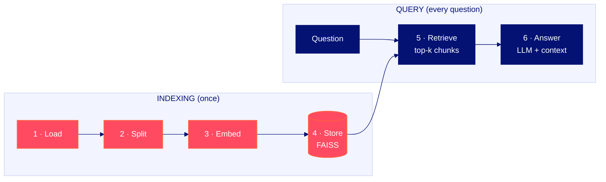

<!-- brand:header:start -->
<p align="center">
  
  <br><br>
  
  <br><br>
  <a href="https://SHASUVATHANAN.COM">SHASUVATHANAN.COM</a> &nbsp;&#8226;&nbsp; <a href="https://www.linkedin.com/in/shasuvathanan">LinkedIn</a>
</p>
<!-- brand:header:end -->

# Phase-007-RAG-Introduction — Retrieval-Augmented Generation

**Shasu Vathanan - GEN AI - Product Manager**

$\textcolor{#FF4A62}{\rule{26em}{4pt}}$

**Find the right text first, then let the model answer from it.**

A language model only knows what it saw during training. It cannot read your documents, and it may answer confidently when it does not know. **Retrieval-Augmented Generation (RAG)** fixes this by retrieving the most relevant passages from your own data and handing them to the model together with the question, so the answer is grounded in real text.

This phase explains what RAG is, compares the main RAG types, and includes three runnable Python demos built on the components from Phase-006-LangChain-Ecosystem.

---

## Quick Navigation

| # | Section | What it covers |
| :-- | :-- | :-- |
| 1 | [How RAG works](#how-rag-works) | The six-step pipeline, as a diagram and in words |
| 2 | [Concept notebooks](#concept-notebooks) | What RAG is, RAG types, Self RAG, Corrective RAG, Fusion RAG, BM25 and rerank |
| 3 | [Runnable demos](#runnable-demos) | Three Python scripts — basic RAG, RAG with LangSmith tracing, and a PDF question-answering app |
| 4 | [Running this phase](#running-this-phase) | Environment, keys and commands |

📄 **Phase explainer:** [RAG-Introduction-Explainer.pdf](./RAG-Introduction-Explainer.pdf) — the whole phase in a 4-page branded guide.

---

## How RAG works



*In words:* the document is loaded, split into chunks, turned into vectors and stored once. For each question, the closest chunks are retrieved and placed in the prompt, and the model answers **using only that text**.

The infographic [Embeddings, Vectors, Binary and RAG Explained.png](./Embeddings,%20Vectors,%20Binary%20and%20RAG%20Explained.png) shows the same idea visually: how text becomes an embedding vector, how those numbers are stored as binary floating-point values, and where vector search fits in a RAG answer.

---

## Concept notebooks

| # | Notebook / guide | What you learn |
| :-- | :-- | :-- |
| 01 | [01_What_is_RAG_and_Why.ipynb](./01_What_is_RAG_and_Why.ipynb) | The problem RAG solves, the basic flow, and why it is used |
| 02 | [02_RAG_Types.ipynb](./02_RAG_Types.ipynb) | Basic (naive) RAG and an overview of the advanced RAG types |
| 03 | [03_Self_RAG.ipynb](./03_Self_RAG.ipynb) | **Self RAG** — the model grades its own retrieval and answer |
| 04 | [04_Corrective_RAG.ipynb](./04_Corrective_RAG.ipynb) | **Corrective RAG (CRAG)** — grade the retrieved documents, then correct weak results |
| 05 | [05_Fusion_RAG.ipynb](./05_Fusion_RAG.ipynb) | **Fusion RAG** — several query variants combined with Reciprocal Rank Fusion (RRF) |
| 06 | [06_BM25_Rerank.ipynb](./06_BM25_Rerank.ipynb) | **BM25** keyword search vs semantic search, and **reranking** the retrieved results |
| Guide | [Multimodal-Retriever-Concepts-and-Architecture.pdf](./Multimodal-Retriever-Concepts-and-Architecture.pdf) | **Multimodal retrieval** — how retrieval works across text, documents, images, audio and video: architecture, recommended tools, hybrid search, storing vs persisting, and a step-by-step implementation workflow |

Notebooks 01–05 explain each idea with flow diagrams and short code sketches (notebook 05 includes a small Reciprocal Rank Fusion scoring example); notebook 06 runs a BM25 keyword search with `rank-bm25`.

The multimodal retriever guide is built from [docs/build_multimodal.py](./docs/build_multimodal.py): run `python Phase-007-RAG-Introduction/docs/build_multimodal.py` from the repository root after editing its text. It needs `reportlab`, `pymupdf` and `pillow`, reuses the brand engine in `zz-Brand-Assets/pdf-kit/`, and checks that every source word, table cell and diagram label is in the PDF.

| | Self RAG | Corrective RAG | Fusion RAG |
| :-- | :-- | :-- | :-- |
| **Checks** | Whether to retrieve, document relevance and its own answer | The quality of the retrieved documents | — |
| **Improves** | Answer reliability | Retrieval quality | Search coverage |
| **Key idea** | Self-grading | Grade, then correct — search again (for example, the web) when retrieval is weak | Ask the question many ways, merge the rankings with RRF |

---

## Runnable demos

| File | What it does |
| :-- | :-- |
| [rag_demo.py](./rag_demo.py) | The six RAG steps over [llm_document.txt](./llm_document.txt) with a local Hugging Face embedding model and FAISS. With `OPENAI_API_KEY` set it asks `gpt-4o-mini` for the answer; without a key it prints the retrieved text |
| [rag_demo_langsmith.py](./rag_demo_langsmith.py) | The same demo with one extra line — `wrap_openai(OpenAI())` — so the model call is traced in LangSmith |
| [rag_faiss_app.py](./rag_faiss_app.py) | An interactive question-answering loop over [spotify_web_app_architecture.pdf](./spotify_web_app_architecture.pdf). It builds a FAISS index on the first run, saves it to `faiss_index/`, and answers only from the document (otherwise *"I don't know from the provided document."*) |

Data files: `llm_document.txt` is a beginner's guide to LLMs used as the knowledge source; `spotify_web_app_architecture.pdf` is a sample architecture document for a hypothetical Spotify-like web app, used as RAG input. It carries the brand cover, header and footer and the Spotify logo (a registered trademark of Spotify AB, shown to identify the app style); the document is not affiliated with or endorsed by Spotify, and its original text is preserved word for word (source: `zz-Brand-Assets/pdf-kit/sources/spotify_web_app_architecture.txt`).

---

## Running this phase

```powershell
cd "Phase-007-RAG-Introduction"
python -m venv venv
venv\Scripts\Activate.ps1
python -m pip install -r requirements.txt
copy .env.example .env      # then paste your own keys into .env

python rag_demo.py
python rag_demo_langsmith.py
python rag_faiss_app.py     # type 'exit' to stop
```

> [!IMPORTANT]
> `rag_faiss_app.py` always calls OpenAI, so it needs `OPENAI_API_KEY`. `rag_demo.py` runs without a key and simply shows the retrieved chunks. The generated `faiss_index/` folder and your `.env` file are git-ignored.

---

## Key takeaways

- RAG keeps the model the same and changes **what it reads** before answering.
- Retrieval quality decides answer quality — splitting, embeddings and top-k all matter.
- Advanced RAG types add checks (Self RAG, CRAG) or better search (Fusion RAG, BM25 + rerank).
- An instruction such as *"answer only from the context"* plus an honest *"I don't know"* is the simplest guard against made-up answers.

---

## Phase map

| Phase | Focus | Document |
| :-- | :-- | :-- |
| [Phase-001-Programming-Foundations](../Phase-001-Programming-Foundations/) | Python fundamentals — the Student Grade System in a terminal | [📄 PDF](../Phase-001-Programming-Foundations/Student%20Grade%20System.pdf) |
| [Phase-002-GenAI-Python-Toolkit](../Phase-002-GenAI-Python-Toolkit/) | Mandatory Python concepts for Generative AI | [📄 PDF](../Phase-002-GenAI-Python-Toolkit/Mandatory%20Python%20Concepts%20for%20Generative%20AI.pdf) |
| [Phase-003-Robotic-Process-Automation-(RPA)](../Phase-003-Robotic-Process-Automation-%28RPA%29/) | RPA — desktop and browser automation | [📄 PDF](../Phase-003-Robotic-Process-Automation-%28RPA%29/RPA%20-%20Robotic%20Process%20Automation.pdf) |
| [Phase-004-FastAPI-And-Streamlit](../Phase-004-FastAPI-And-Streamlit/) | Interfaces and APIs — Streamlit and FastAPI | [📄 PDFs](../Phase-004-FastAPI-And-Streamlit/) |
| [Phase-005-LLM-Foundations-and-Practical-Tools](../Phase-005-LLM-Foundations-and-Practical-Tools/) | LLM foundations and practical tools | [📄 PDFs](../Phase-005-LLM-Foundations-and-Practical-Tools/) |
| [Phase-006-LangChain-Ecosystem](../Phase-006-LangChain-Ecosystem/) | LangChain building blocks and model integration | [📄 PDF](../Phase-006-LangChain-Ecosystem/LangChain-Ecosystem-Explainer.pdf) |
| **Phase-007-RAG-Introduction** | **Retrieval-Augmented Generation — concepts, types and working demos** | [📄 PDF](./RAG-Introduction-Explainer.pdf) |
| [Phase-008-RAG-Agent-Explained](../Phase-008-RAG-Agent-Explained/) | RAG as a tool for an AI agent — CrewAI + MCP + ChromaDB, with a chat UI and an API | [📄 PDF](../Phase-008-RAG-Agent-Explained/RAG-Agent-Explained-Explainer.pdf) |

## Navigation

| Previous | Index | Next |
| :-- | :--: | --: |
| [← Phase-006-LangChain-Ecosystem](../Phase-006-LangChain-Ecosystem/) | [Journey index](../README.md) | [Phase-008-RAG-Agent-Explained →](../Phase-008-RAG-Agent-Explained/) |

$\textcolor{#FF4A62}{\rule{20em}{2pt}}$

## Contributing

Feel free to fork this repository, improve the content, and share your knowledge with the community.

---

**Created and Maintained by:**

### **Shasu Vathanan - GEN AI - Product Manager**

<a href="https://shasuvathanan.com" target="_blank">SHASUVATHANAN.COM</a> &nbsp;&#8226;&nbsp; <a href="https://www.linkedin.com/in/shasuvathanan" target="_blank">LinkedIn</a>

<!-- brand:footer:start -->
<!-- brand:social:start -->
<p align="center">
  <a href="https://shasuvathanan.com"></a>
  &nbsp;
  <a href="mailto:shasu1pm@gmail.com"></a>
  &nbsp;
  <a href="https://linkedin.com/in/shasuvathanan"></a>
  &nbsp;
  <a href="https://github.com/shasu1pm"></a>
  &nbsp;
  <a href="https://huggingface.co/Shasuvathanan"></a>
  &nbsp;
  <a href="https://www.youtube.com/@ShasuVathanan"></a>
  &nbsp;
  <a href="https://x.com/shasuvathanan"></a>
  &nbsp;
  <a href="https://higgsfield.ai/@shasuvathanan"></a>
  <br>
  <sub><b>Connect:</b> <a href="https://shasuvathanan.com">Website</a> &nbsp;&#8226;&nbsp; <a href="mailto:shasu1pm@gmail.com">Email</a> &nbsp;&#8226;&nbsp; <a href="https://linkedin.com/in/shasuvathanan">LinkedIn</a> &nbsp;&#8226;&nbsp; <a href="https://github.com/shasu1pm">GitHub</a> &nbsp;&#8226;&nbsp; <a href="https://huggingface.co/Shasuvathanan">Hugging Face</a> &nbsp;&#8226;&nbsp; <a href="https://www.youtube.com/@ShasuVathanan">YouTube</a> &nbsp;&#8226;&nbsp; <a href="https://x.com/shasuvathanan">X (Twitter)</a> &nbsp;&#8226;&nbsp; <a href="https://higgsfield.ai/@shasuvathanan">Higgsfield AI</a></sub>
</p>
<!-- brand:social:end -->
<p align="center">
  
  <br>
  <sub><b>Shasu Vathanan - GEN AI - Product Manager</b> &nbsp;&#8226;&nbsp; NeGot, my AI avatar &nbsp;&#8226;&nbsp; <a href="../README.md">Back to the journey index</a></sub>
</p>
<!-- brand:footer:end -->
