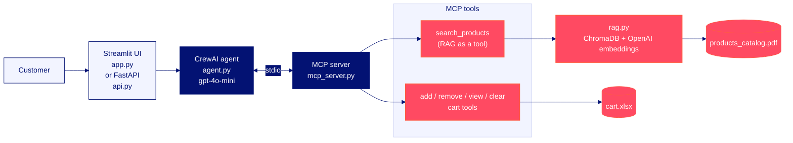

<!-- brand:header:start -->
<p align="center">
  
  <br><br>
  
  <br><br>
  <a href="https://SHASUVATHANAN.COM">SHASUVATHANAN.COM</a> &nbsp;&#8226;&nbsp; <a href="https://www.linkedin.com/in/shasuvathanan">LinkedIn</a>
</p>
<!-- brand:header:end -->

# Phase-008-RAG-Agent-Explained — RAG as a Tool for an AI Agent

**Shasu Vathanan - GEN AI - Product Manager**

$\textcolor{#FF4A62}{\rule{26em}{4pt}}$

**Turn RAG into a tool, serve it through MCP, and let an AI agent decide when to search and when to act.**

A standalone RAG app can answer questions about your documents, but it cannot *do* anything. Real workflows need both: a customer asks *"which wireless products do you have?"* and then says *"add the mouse to my cart"*. In this phase I turned RAG into **one tool among several**, published those tools through an **MCP (Model Context Protocol) server**, and gave them to a **CrewAI shopping agent**. A Streamlit chat UI and a FastAPI service put the agent in front of people and other applications.

The use case is **ShopEasy**, a hypothetical online store with a 12-product catalogue.

---

## Quick Navigation

| # | Section | What it covers |
| :-- | :-- | :-- |
| 1 | [From RAG to a RAG agent](#from-rag-to-a-rag-agent) | The RAG workflow and why an agent needs more than RAG |
| 2 | [Architecture](#architecture) | Agent + RAG + MCP, as a diagram and in words |
| 3 | [Files in this folder](#files-in-this-folder) | What each file does |
| 4 | [The MCP tools](#the-mcp-tools) | One RAG tool and four cart tools |
| 5 | [Running this phase](#running-this-phase) | Environment, key, agent, Streamlit UI and FastAPI |
| 6 | [How a conversation flows](#how-a-conversation-flows) | Search, add to cart, memory |
| 7 | [From demo to production](#from-demo-to-production) | What to change before real customers use it |
| 8 | [References & Credits](#references--credits) | Where the idea came from and the open-source libraries it uses |

📄 **Phase explainer:** [RAG-Agent-Explained-Explainer.pdf](./RAG-Agent-Explained-Explainer.pdf) — the whole phase in a 5-page branded guide.

---

## From RAG to a RAG agent

**RAG (Retrieval-Augmented Generation)** feeds your own documents to a language model:

1. **Load** the documents — a PDF, an Excel file or website data.
2. **Split** them into small chunks.
3. **Embed** each chunk — the text is converted into numbers (vectors).
4. **Store** the vectors in a vector database.
5. **Embed the question** the same way and **search** the database for the closest chunks.
6. **Answer** — the related chunks go to the LLM together with the question.

[Phase-007-RAG-Introduction](../Phase-007-RAG-Introduction/) built this with LangChain and FAISS. Here the same steps are written directly with **pypdf** and **ChromaDB** in [rag.py](./rag.py). ChromaDB and FAISS are open source and run inside your Python process, so no separate database server is needed.

RAG on its own only answers. Teams now automate whole workflows with **AI agents**, so the RAG pipeline becomes a **tool** that an agent can call — next to tools that take actions.

---

## Architecture



*In words:* the customer talks to the Streamlit UI or the API. Both pass the message to the CrewAI agent. The agent does not touch the database or the cart file itself — it starts the MCP server and sees only the **names and descriptions** of its tools. For product questions it calls `search_products`, which runs the RAG search over the catalogue; for cart requests it calls a cart tool, which reads and writes `cart.xlsx`. The agent then writes a short, friendly reply.

**Why MCP instead of attaching the RAG tool directly?** MCP gives every tool one standard interface, so the agent loads whatever the server offers. New capabilities — for example an email notifier, a real database or a meeting-booking calendar — can be added as further MCP tools without rewriting the agent. Those extensions are ideas for the next step; this folder implements the product search and the cart.

---

## Files in this folder

| File | What it does |
| :-- | :-- |
| [products_catalog.pdf](./products_catalog.pdf) | The knowledge source — 12 ShopEasy products, each with name, ID, category, price and details, plus the delivery and returns note |
| [rag.py](./rag.py) | Reads the PDF with pypdf, splits it on `Product Name:` (one chunk per product), embeds the chunks with OpenAI `text-embedding-3-small` and stores them in a persistent ChromaDB collection (`chroma_db/`) on the first run |
| [mcp_server.py](./mcp_server.py) | A FastMCP server named `product-shop` exposing five tools; creates an empty `cart.xlsx` if none exists |
| [agent.py](./agent.py) | Starts the MCP server over stdio with `MCPServerAdapter`, builds the CrewAI **Agent** (Shopping Assistant), **Task** (history + new question) and **Crew**; running it asks one test question |
| [app.py](./app.py) | Streamlit chat UI with the cart and its total in the sidebar — for demos, not for production |
| [api.py](./api.py) | FastAPI service: `POST /ask`, `GET /cart`, Swagger UI at `/docs` |
| [cart.xlsx](./cart.xlsx) | An empty cart template (`product_name`, `price`, `quantity`, `total`) that the cart tools fill — stands in for a real database. `total` is calculated by `add_to_cart` (price × quantity); `mcp_server.py` recreates the file if it is missing |
| [requirements.txt](./requirements.txt) | CrewAI, CrewAI tools (MCP), MCP, OpenAI, ChromaDB, pypdf, Streamlit, FastAPI, Uvicorn, pandas, openpyxl, python-dotenv |
| [.env.example](./.env.example) | Template for `OPENAI_API_KEY` |

The agent's instructions (its *backstory*) carry the grounding rules: always use `search_products` for questions about products, prices or features; answer only from what it returns; never make up products or prices; look up the exact name and price before adding to the cart.

Data file note: `products_catalog.pdf` carries the brand cover, header and footer. Its original catalogue text is preserved word for word (source: `zz-Brand-Assets/pdf-kit/sources/products_catalog.txt`, rebuilt by `build_catalog_sample.py`, which also checks that `rag.py` still produces one chunk per product). The brand header and footer lines are therefore also part of the retrieved text.

---

## The MCP tools

| Tool | What it does | Uses RAG? |
| :-- | :-- | :-- |
| `search_products(question)` | Queries ChromaDB and returns the **3** closest product chunks | ✅ Yes |
| `add_to_cart(product_name, price, quantity=1)` | Adds a product, or raises its quantity if it is already in the cart, and recalculates totals | — |
| `remove_from_cart(product_name)` | Removes one product by name | — |
| `view_cart()` | Lists every item and the grand total | — |
| `clear_cart()` | Empties the cart | — |

---

## Running this phase

```powershell
cd "Phase-008-RAG-Agent-Explained"
python -m venv venv
venv\Scripts\Activate.ps1
python -m pip install -r requirements.txt
copy .env.example .env          # then add your own OPENAI_API_KEY

python agent.py                 # one-question smoke test in the terminal
streamlit run app.py            # chat UI at http://localhost:8501
uvicorn api:app --reload        # API at http://127.0.0.1:8000 — try it at /docs
```

In the Swagger UI at `/docs`, open **POST /ask**, choose **Try it out**, enter a question such as *"What wireless products are available?"* and choose **Execute**; then open **GET /cart** to see what the agent has added.

> [!IMPORTANT]
> Both the embeddings and the agent call OpenAI, so `OPENAI_API_KEY` is required. The first import of `rag.py` builds `chroma_db/`; delete that folder whenever `products_catalog.pdf` changes so the index is rebuilt. `chroma_db/`, `venv/` and your `.env` file are git-ignored.

---

## How a conversation flows

| Customer says | What the agent does | Result |
| :-- | :-- | :-- |
| *"What wireless products are available?"* | Calls `search_products` → ChromaDB returns the three closest catalogue chunks | A short answer drawn from those products, for example the Wireless Mouse (Rs. 499) and the Bluetooth Headphones (Rs. 2999) |
| *"Add the wireless mouse to my cart."* | No RAG needed — calls `add_to_cart` with the exact name and price it found | `cart.xlsx` is updated and the Streamlit sidebar shows the cart and total |
| *"What is in my cart?"* | Calls `view_cart` | Items and grand total |

**Memory:** `app.py` sends the last six chat messages as `history` with every question, so follow-ups such as *"add it"* make sense. `POST /ask` accepts the same `history` field.

The exact wording of each answer varies between runs because the reply is written by the model.

---

## From demo to production

| In this demo | In a real shop |
| :-- | :-- |
| `cart.xlsx` on disk | A real database, connected through its own MCP tool or credentials |
| Streamlit chat UI | Streamlit is for demos; production front ends (a website or online store) call the FastAPI service |
| Price passed to `add_to_cart` by the agent | Recommended: look the price up again on the server before saving |
| Open API on localhost | Recommended: authentication, rate limits and one cart per customer |
| CrewAI | Other agent frameworks such as AutoGen or Google's agent SDK can follow the same pattern |

---

## Key takeaways

- **RAG becomes a tool**, so the agent decides when to search the catalogue and when to act on the cart.
- **MCP** is the connector: one server, many tools, and new tools without changing the agent.
- **Grounding rules** in the agent's backstory, plus tools that return real data, prevent invented products and prices.
- **API first:** the same crew powers the chat UI and the HTTP service, so any application can use it.

---

## References & Credits

**Original walkthrough.** The e-commerce RAG-agent idea (RAG as a tool, served through MCP to a CrewAI agent, with a Streamlit UI and a FastAPI service) and the first version of this code follow a public video walkthrough by another educator, who shared the code openly. All documentation in this folder is written in my own words, and nothing from the video is reproduced. I reviewed and extended the code: brand on the Streamlit UI and the API docs page, a safer intro chunk in `rag.py`, purpose notes in every module, an unused dependency removed, a rebuilt product catalogue and an empty cart template. No licence was published with the original code, so all rights to the original remain with its author.

**Open-source libraries** (installed from `requirements.txt`, not copied into this repository; each keeps its own licence):

| Library | Used for | Licence |
| :-- | :-- | :-- |
| [CrewAI](https://github.com/crewAIInc/crewAI) and CrewAI Tools | Agent, task, crew and the MCP adapter | MIT |
| [MCP Python SDK](https://github.com/modelcontextprotocol/python-sdk) | FastMCP server and stdio transport | MIT |
| [ChromaDB](https://github.com/chroma-core/chroma) | Vector database | Apache-2.0 |
| [OpenAI Python](https://github.com/openai/openai-python) | Embeddings and the `gpt-4o-mini` model | Apache-2.0 |
| [pypdf](https://github.com/py-pdf/pypdf) | Reading the catalogue PDF | BSD-3-Clause |
| [Streamlit](https://github.com/streamlit/streamlit) | Chat UI | Apache-2.0 |
| [FastAPI](https://github.com/fastapi/fastapi) and [Uvicorn](https://github.com/encode/uvicorn) | HTTP API and server | MIT · BSD-3-Clause |
| [pandas](https://github.com/pandas-dev/pandas) and [openpyxl](https://foss.heptapod.net/openpyxl/openpyxl) | Reading and writing `cart.xlsx` | BSD-3-Clause · MIT |
| [python-dotenv](https://github.com/theskumar/python-dotenv) | Loading `OPENAI_API_KEY` from `.env` | BSD-3-Clause |

ShopEasy, its products and prices are sample data for a hypothetical store.

---

## Phase map

| Phase | Focus | Document |
| :-- | :-- | :-- |
| [Phase-001-Programming-Foundations](../Phase-001-Programming-Foundations/) | Python fundamentals — the Student Grade System in a terminal | [📄 PDF](../Phase-001-Programming-Foundations/Student%20Grade%20System.pdf) |
| [Phase-002-GenAI-Python-Toolkit](../Phase-002-GenAI-Python-Toolkit/) | Mandatory Python concepts for Generative AI | [📄 PDF](../Phase-002-GenAI-Python-Toolkit/Mandatory%20Python%20Concepts%20for%20Generative%20AI.pdf) |
| [Phase-003-Robotic-Process-Automation-(RPA)](../Phase-003-Robotic-Process-Automation-%28RPA%29/) | RPA — desktop and browser automation | [📄 PDF](../Phase-003-Robotic-Process-Automation-%28RPA%29/RPA%20-%20Robotic%20Process%20Automation.pdf) |
| [Phase-004-FastAPI-And-Streamlit](../Phase-004-FastAPI-And-Streamlit/) | Interfaces and APIs — Streamlit and FastAPI | [📄 PDFs](../Phase-004-FastAPI-And-Streamlit/) |
| [Phase-005-LLM-Foundations-and-Practical-Tools](../Phase-005-LLM-Foundations-and-Practical-Tools/) | LLM foundations and practical tools | [📄 PDFs](../Phase-005-LLM-Foundations-and-Practical-Tools/) |
| [Phase-006-LangChain-Ecosystem](../Phase-006-LangChain-Ecosystem/) | LangChain building blocks and model integration | [📄 PDF](../Phase-006-LangChain-Ecosystem/LangChain-Ecosystem-Explainer.pdf) |
| [Phase-007-RAG-Introduction](../Phase-007-RAG-Introduction/) | Retrieval-Augmented Generation — concepts, types and working demos | [📄 PDF](../Phase-007-RAG-Introduction/RAG-Introduction-Explainer.pdf) |
| **Phase-008-RAG-Agent-Explained** | **RAG as a tool for an AI agent — CrewAI + MCP + ChromaDB, with a chat UI and an API** | [📄 PDF](./RAG-Agent-Explained-Explainer.pdf) |

## Navigation

| Previous | Index | Next |
| :-- | :--: | --: |
| [← Phase-007-RAG-Introduction](../Phase-007-RAG-Introduction/) | [Journey index](../README.md) | Next phase (coming next) |

$\textcolor{#FF4A62}{\rule{20em}{2pt}}$

## Contributing

Feel free to fork this repository, improve the content, and share your knowledge with the community.

---

**Created and Maintained by:**

### **Shasu Vathanan - GEN AI - Product Manager**

<a href="https://shasuvathanan.com" target="_blank">SHASUVATHANAN.COM</a> &nbsp;&#8226;&nbsp; <a href="https://www.linkedin.com/in/shasuvathanan" target="_blank">LinkedIn</a>

<!-- brand:footer:start -->
<!-- brand:social:start -->
<p align="center">
  <a href="https://shasuvathanan.com"></a>
  &nbsp;
  <a href="mailto:shasu1pm@gmail.com"></a>
  &nbsp;
  <a href="https://linkedin.com/in/shasuvathanan"></a>
  &nbsp;
  <a href="https://github.com/shasu1pm"></a>
  &nbsp;
  <a href="https://huggingface.co/Shasuvathanan"></a>
  &nbsp;
  <a href="https://www.youtube.com/@ShasuVathanan"></a>
  &nbsp;
  <a href="https://x.com/shasuvathanan"></a>
  &nbsp;
  <a href="https://higgsfield.ai/@shasuvathanan"></a>
  <br>
  <sub><b>Connect:</b> <a href="https://shasuvathanan.com">Website</a> &nbsp;&#8226;&nbsp; <a href="mailto:shasu1pm@gmail.com">Email</a> &nbsp;&#8226;&nbsp; <a href="https://linkedin.com/in/shasuvathanan">LinkedIn</a> &nbsp;&#8226;&nbsp; <a href="https://github.com/shasu1pm">GitHub</a> &nbsp;&#8226;&nbsp; <a href="https://huggingface.co/Shasuvathanan">Hugging Face</a> &nbsp;&#8226;&nbsp; <a href="https://www.youtube.com/@ShasuVathanan">YouTube</a> &nbsp;&#8226;&nbsp; <a href="https://x.com/shasuvathanan">X (Twitter)</a> &nbsp;&#8226;&nbsp; <a href="https://higgsfield.ai/@shasuvathanan">Higgsfield AI</a></sub>
</p>
<!-- brand:social:end -->
<p align="center">
  
  <br>
  <sub><b>Shasu Vathanan - GEN AI - Product Manager</b> &nbsp;&#8226;&nbsp; NeGot, my AI avatar &nbsp;&#8226;&nbsp; <a href="../README.md">Back to the journey index</a></sub>
</p>
<!-- brand:footer:end -->
