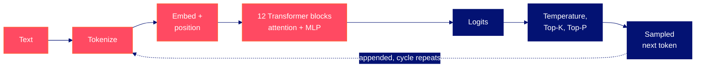

<!-- brand:header:start -->

  
    
  
    
  <a href="https://SHASUVATHANAN.COM">SHASUVATHANAN.COM</a> &nbsp;&#8226;&nbsp; <a href="https://www.linkedin.com/in/shasuvathanan">LinkedIn</a>

<!-- brand:header:end -->

# Transformer Explorer — From Words to Meaning

**Shasu Vathanan - GEN AI - Product Manager**

$\textcolor{#FF4A62}{\rule{26em}{4pt}}$

📘 **Explainer:** [Transformer-Explorer-Explainer.pdf](./Transformer-Explorer-Explainer.pdf) — this folder in a short, branded guide.

**Type → Run → Watch → Click → Explore → Understand.**

An interactive, offline learning playground that shows how a Transformer turns a sentence into tokens, passes them through attention and feed-forward blocks, and scores the next token. It comes with an illustrated guide of **20 guided lessons** and four repeatable experiments.

This is a companion guide to the journey. It sits beside Phase-005-LLM-Foundations-and-Practical-Tools (what an LLM is) and before Phase-006-LangChain-Ecosystem (building applications around one).

---

## What is in this folder

| File | What it is |
| :-- | :-- |
| [Transformer-Explorer.html](./Transformer-Explorer.html) | The standalone playground — a single HTML file. Download it and open it in a modern browser; no installation, account or internet connection is needed |
| [Transformer-Explorer-Guide-Part-1.pdf](./Transformer-Explorer-Guide-Part-1.pdf) | Illustrated guide, part 1 of 2 (13 pages) — start-here steps and lessons 01–11 |
| [Transformer-Explorer-Guide-Part-2.pdf](./Transformer-Explorer-Guide-Part-2.pdf) | Part 2 of 2 (12 pages) — lessons 12–20, four experiments and the technical reference |

> [!NOTE]
> GitHub shows `.html` files as source code. To use the playground, download `Transformer-Explorer.html` and open it locally.

---

## How the playground computes a next token

*In words:* text is split into tokens, each token gets an embedding plus position information, twelve blocks of attention and MLP layers refine those vectors, the last position is turned into scores (logits), the sampling settings turn scores into probabilities, and one token is chosen and appended.

---

## The 20 lessons

| # | Lesson | # | Lesson |
| :-- | :-- | :-- | :-- |
| 01 | What is a Transformer? | 11 | Masked Self Attention |
| 02 | How Transformers Work | 12 | Attention Output & Concatenation |
| 03 | Transformer Architecture | 13 | MLP (Multi-Layer Perceptron) |
| 04 | Embedding | 14 | Output Logit |
| 05 | Token Embedding | 15 | Probabilities |
| 06 | Positional Encoding | 16 | Temperature |
| 07 | Repetitive Transformer Blocks | 17 | Sampling Strategy |
| 08 | Multi-Head Self Attention | 18 | Residual Connection |
| 09 | Query, Key, Value | 19 | Layer Normalization |
| 10 | Multi-head | 20 | Dropout |

**Four experiments** close the guide: repeated words at different positions, temperature acting after attention, Top-K = 1 removing sampling uncertainty, and why changing the view is not changing the model.

---

## Scope and limitations

- The playground runs a **small, untrained, seeded simulation** (24-dimensional embeddings, 12 causal decoder blocks, 1–12 attention heads). It demonstrates the mechanics; it does **not** understand language and does **not** run GPT-2.
- **Educational source:** the learning approach is informed by Cho, Aeree, et al. (2026), *Transformer Explainer: Learning LLM Transformers with Interactive Visual Explanation and Experimentation*, CHI '26, DOI [10.1145/3772318.3791725](https://doi.org/10.1145/3772318.3791725). This project is an independent offline implementation; it does not reproduce the paper's trained model, outputs, study results or code.

---

## Where this fits in the journey

| Step | Folder | Focus |
| :-- | :-- | :-- |
| Before | [Phase-005-LLM-Foundations-and-Practical-Tools](../Phase-005-LLM-Foundations-and-Practical-Tools/) | What an LLM is, model families, access and local inference |
| **This guide** | **Transformer-Explorer-Guide** | **How a Transformer produces the next token** |
| After | [Phase-006-LangChain-Ecosystem](../Phase-006-LangChain-Ecosystem/) | Building applications around a model with LangChain |

$\textcolor{#FF4A62}{\rule{20em}{2pt}}$

## Contributing

Feel free to fork this repository, improve the content, and share your knowledge with the community.

---

**Created and Maintained by:**

### **Shasu Vathanan - GEN AI - Product Manager**

<a href="https://shasuvathanan.com" target="_blank">SHASUVATHANAN.COM</a> &nbsp;&#8226;&nbsp; <a href="https://www.linkedin.com/in/shasuvathanan" target="_blank">LinkedIn</a>

<!-- brand:footer:start -->
<!-- brand:social:start -->

  
  &nbsp;
  
  &nbsp;
  
  &nbsp;
  
  &nbsp;
  
  &nbsp;
  
  &nbsp;
  
  &nbsp;
  
   
  <b>Connect:</b> <a href="https://shasuvathanan.com">Website</a> &nbsp;&#8226;&nbsp; <a href="mailto:shasu1pm@gmail.com">Email</a> &nbsp;&#8226;&nbsp; <a href="https://linkedin.com/in/shasuvathanan">LinkedIn</a> &nbsp;&#8226;&nbsp; <a href="https://github.com/shasu1pm">GitHub</a> &nbsp;&#8226;&nbsp; <a href="https://huggingface.co/Shasuvathanan">Hugging Face</a> &nbsp;&#8226;&nbsp; <a href="https://www.youtube.com/@ShasuVathanan">YouTube</a> &nbsp;&#8226;&nbsp; <a href="https://x.com/shasuvathanan">X (Twitter)</a> &nbsp;&#8226;&nbsp; <a href="https://higgsfield.ai/@shasuvathanan">Higgsfield AI</a>

<!-- brand:social:end -->

  
   
  <b>Shasu Vathanan - GEN AI - Product Manager</b> &nbsp;&#8226;&nbsp; NeGot, my AI avatar &nbsp;&#8226;&nbsp; <a href="../README.md">Back to the journey index</a>

<!-- brand:footer:end -->
